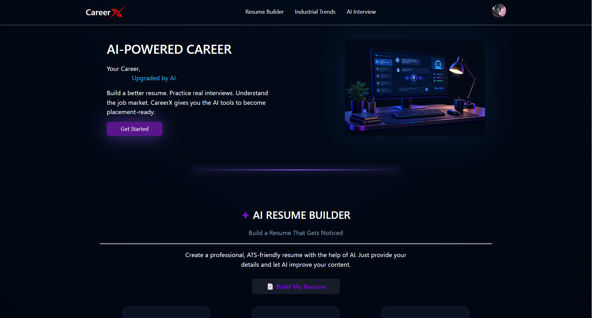
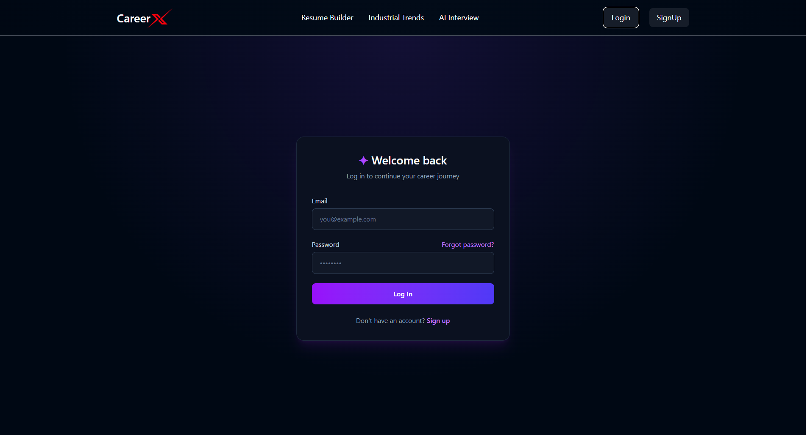
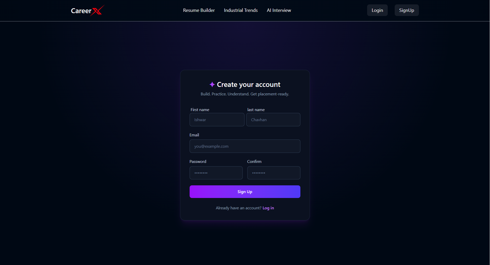
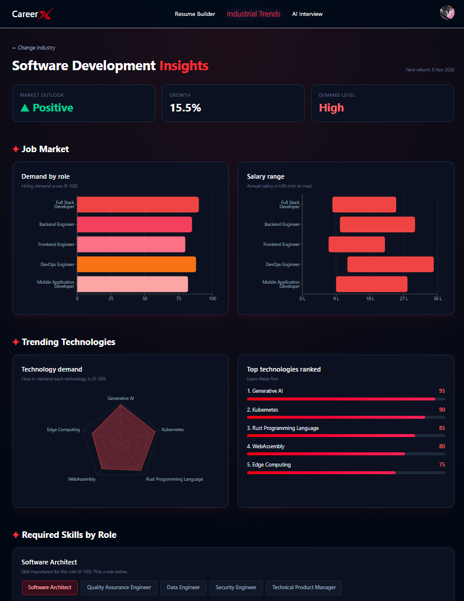
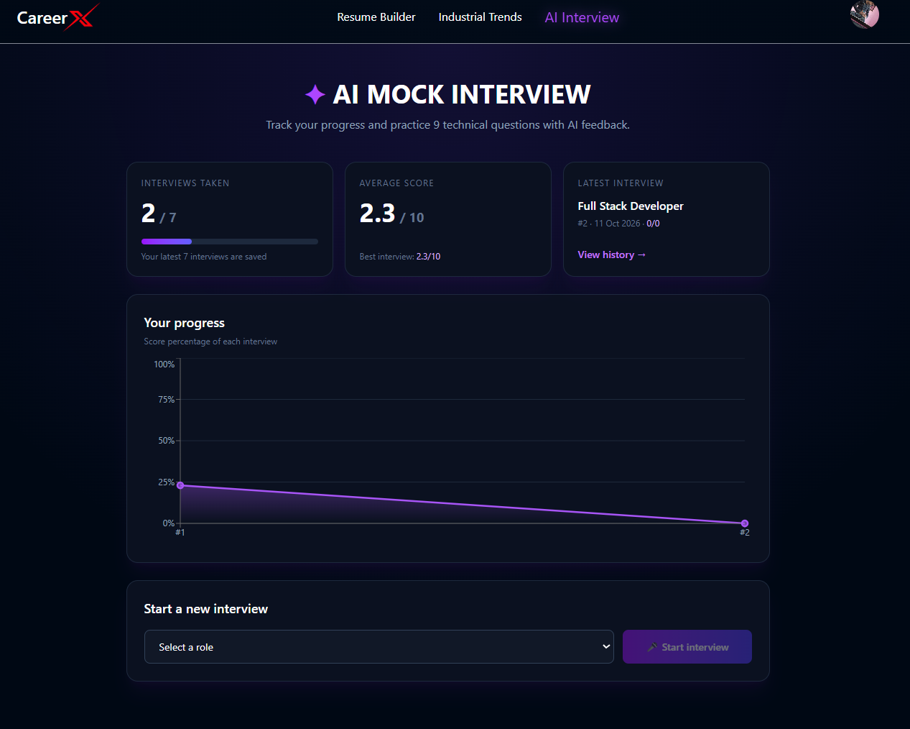
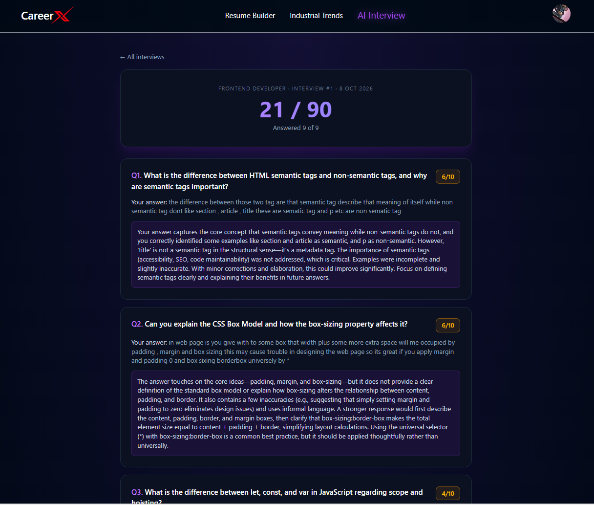
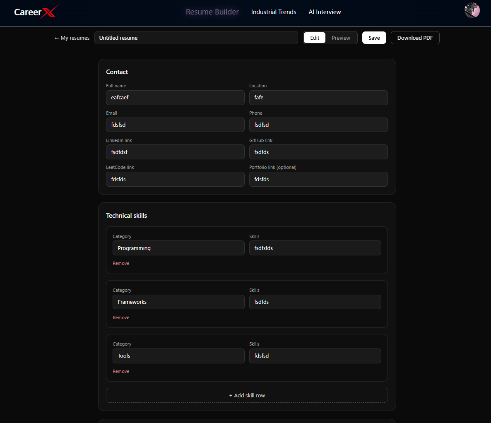
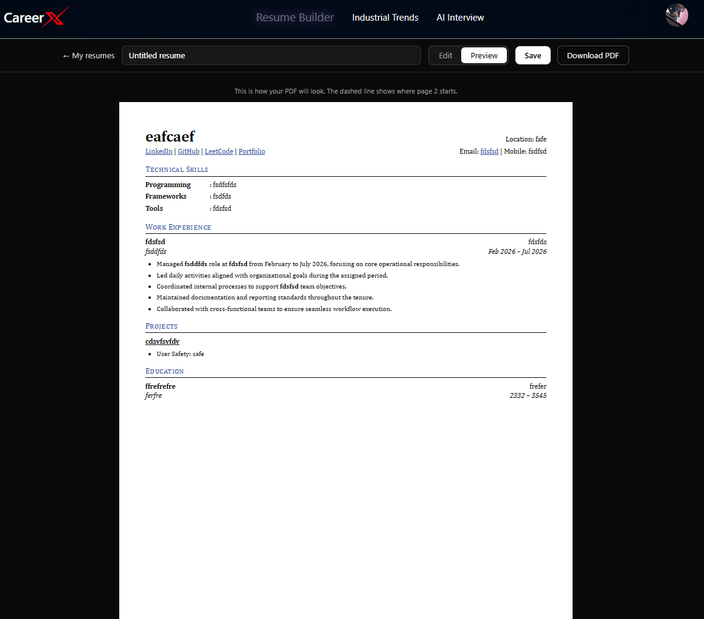

# CareerX - AI Career Coach

CareerX helps job seekers prepare for placements in one place: **see which technologies are trending in a field, build a resume and download it as a PDF, and practise with an AI mock interview** that scores your answers and tracks your progress.

- **Live demo:** https://career-x-ten.vercel.app

---

## Screenshots

| Home | Login |
|------|-------|
|  |  |

| Signup | Industry Insights |
|--------|-------------------|
|  |  |

| AI Mock Interview Dashboard | Interview Result |
|-----------------------------|------------------|
|  |  |

| Resume Editor | Resume Preview |
|---------------|----------------|
|  |  |

---

## Features

### AI Mock Interview
- Pick a role and answer 9 technical questions generated by AI
- Each answer gets a score out of 10 and written feedback, with the total shown on the result page right after the interview
- Dashboard shows interviews taken, average score, your latest interview and a progress graph
- History page lists past interviews (the latest 7 are kept per user)

### Resume Builder
- Create, edit and delete multiple resumes
- Sections: contact (LinkedIn, GitHub, LeetCode, portfolio), technical skills by category, work experience, projects and education
- Switch between **Edit** and **Preview**; the preview shows how the PDF will look, including where page 2 starts
- Save your work and **download the resume as a PDF**
- AI improver rewrites weak text into stronger, results-focused points

### Industry Insights
- Choose a field (for example, Software Development) and see:
  - market outlook, growth rate and demand level
  - demand by role and salary range (in LPA)
  - trending technologies as a radar chart and a ranked list
  - required skills by role
- Insights show a "next refresh" date so the data is updated regularly

### Accounts
- Signup and login with email OTP verification and a forgot-password option
- Profile with your details and picture
- Role-based access (User / Admin) and JWT-protected routes

---

## Tech Stack

| Layer | Technologies |
|-------|--------------|
| Frontend | React, Tailwind CSS |
| Backend | Node.js, Express.js |
| Database | MongoDB, Mongoose |
| Auth | JWT, bcrypt, email OTP |
| AI | LLM API for interview questions, answer evaluation, resume improvement and industry insights |
| Deployment | Vercel (frontend) |

---

## How It Works

```
React app (Vercel)
      |  REST API calls (JWT in header)
      v
Express API  -- auth middleware
      |          |            |
   MongoDB    LLM API     Email (OTP)
```

**Mock interview flow:** choose role -> AI generates questions -> user answers -> AI evaluates each answer and returns a score and feedback -> result is saved to history -> progress graph updates.

**AI output:** prompts ask the model for structured JSON, which the backend parses and validates before saving or showing it.

---

## Project Structure

```
careerX/
├── backend/     # Express API (auth, interview, resume, insights)
├── frontend/    # React + Tailwind app
└── .gitignore
```

---

## Getting Started

### Prerequisites
- Node.js 18+
- A MongoDB database (Atlas or local)
- An API key for your LLM provider
- An email account for sending OTPs (SMTP)

### 1. Clone and install

```bash
git clone https://github.com/ishwar-chavhan/careerX.git
cd careerX

cd backend && npm install
cd ../frontend && npm install
```

### 2. Environment variables

Create a `.env` file in `backend/` and another in `frontend/`. Set values for:

**Backend**
```env
PORT=
MONGODB_URL=
JWT_SECRET=
MAIL_HOST=
MAIL_USER=
MAIL_PASS=
LLM_API_KEY=
```

**Frontend**
```env
VITE_API_URL=
```

### 3. Run

```bash
# terminal 1
cd backend && npm run dev

# terminal 2
cd frontend && npm run dev
```

Open the local URL shown in the frontend terminal.

---

## Future Improvements

- Voice and video mock interviews
- ATS score and job description matching for resumes
- Rate limiting, automated tests and better analytics on weak topics

---

## Author

**Ishwar Chavhan** - [GitHub](https://github.com/ishwar-chavhan)
